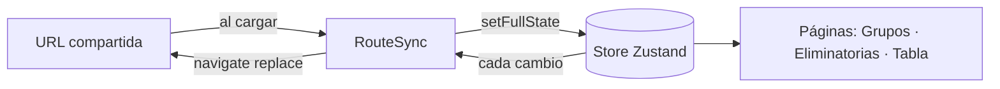

# ⚽ Prode Mundial 2026

Simulador interactivo y **no oficial** del Mundial FIFA 2026. Cargá los resultados de la fase de grupos, mirá cómo se arma el cuadro de eliminatorias y llevá a tu campeón hasta la final. Todo el torneo se guarda **en la URL**, así que compartir tu pronóstico es copiar un enlace: sin registro, sin backend, sin base de datos.

> Este proyecto no está afiliado a la FIFA. Es una herramienta de fans para fans.

## Características

- **Fase de grupos**: 12 grupos (A–L) de 4 equipos, 72 partidos. Las tablas de posiciones se recalculan solas al cargar cada resultado.
- **Fair play**: cada partido admite tarjetas amarillas, dobles amarillas y rojas directas, que alimentan el criterio de desempate por conducta.
- **Mejores terceros**: tabla con los 8 mejores terceros que avanzan, junto a los 12 primeros y los 12 segundos.
- **Cuadro de eliminatorias**: 16avos, octavos, cuartos, semifinales, tercer puesto y final (partidos M73–M104). Los cruces de los terceros se resuelven con la tabla oficial de las 495 combinaciones posibles (Anexo C del reglamento).
- **Penales**: si un partido eliminatorio termina empatado, elegís quién gana por penales.
- **Tabla general**: ranking de las 48 selecciones ordenado por instancia alcanzada, puntos, diferencia de gol y goles a favor.
- **Aleatoriedad**: un dado general simula el torneo entero y un dado por partido simula uno solo. Los resultados se generan con probabilidades ponderadas por el ranking FIFA.
- **Compartir y retomar**: el estado vive en la URL; abrir el enlace restaura el torneo exacto.
- **Modo oscuro** y vista móvil propia para el cuadro de eliminatorias.

## Empezar

Requisitos: [Node.js](https://nodejs.org/) 18 o superior y npm.

```bash
git clone https://github.com/Kyriokes/ProdeMundial2026.git
cd ProdeMundial2026
npm install
npm run dev
```

Vite imprime la URL local en la terminal (por defecto `http://localhost:5173`).

## Scripts

| Comando | Qué hace |
| --- | --- |
| `npm run dev` | Servidor de desarrollo con HMR |
| `npm run build` | Chequeo de tipos (`tsc -b`) y build de producción en `dist/` |
| `npm run preview` | Sirve el build de producción localmente |
| `npm run check` | Chequeo de tipos sin generar archivos |
| `npm run lint` | ESLint sobre todo el proyecto |

## Cómo se usa

1. **Grupos** (`/groups`): ingresá los goles de cada partido, o usá el dado para sortearlos. Cuando los 72 partidos tienen resultado se habilita *Continuar a Fase Eliminatoria*.
2. **Eliminatorias** (`/knockout`): completá cada cruce hasta coronar al campeón. Los ganadores avanzan solos por el cuadro.
3. **Tabla** (`/stats`): resumen del torneo con la instancia que alcanzó cada selección.

En la barra superior tenés **Compartir** (copia el enlace), **Randomizar** (simula todo el torneo, pide confirmación), **Borrar todo** y **Instrucciones**.

### Los seis cupos de repechaje

El Mundial tiene seis plazas que aún se definen por repechaje. La app las trae resueltas por defecto, y esos equipos son los que aparecen en los grupos:

| Cupo | Grupo | Selección por defecto |
| --- | --- | --- |
| Ruta UEFA A | B | Bosnia&Herzegovina |
| Ruta UEFA B | F | Suecia |
| Ruta UEFA C | D | Turquía |
| Ruta UEFA D | A | República Checa |
| Llave intercontinental A | K | R.D. Congo |
| Llave intercontinental B | I | Irak |

La pantalla de selección de clasificados (`src/pages/QualifiersPage.tsx`) sigue en el código pero hoy **no está enlazada** en el router, así que desde la interfaz no se pueden cambiar estos cupos. El estado igual los guarda y los lee desde la URL (ver más abajo).

## Reglas implementadas

### Fase de grupos

Victoria 3 puntos, empate 1, derrota 0. Si dos o más equipos empatan en puntos, el código desempata en este orden (`src/utils/calculations.ts`, `resolveTies`):

1. Diferencia de gol en todos los partidos del grupo
2. Goles a favor en todos los partidos del grupo
3. Resultados entre los equipos empatados (puntos, diferencia de gol y goles a favor en esos partidos)
4. Fair play: amarilla −1, doble amarilla −3, roja directa −4 (más cerca de 0 es mejor)
5. Ranking FIFA

> **Ojo:** el reglamento oficial (Artículo 13, incluido en [`public/wc-2026-regulations.pdf`](public/wc-2026-regulations.pdf)) aplica el enfrentamiento directo *antes* que la diferencia de gol y los goles a favor generales. La app todavía sigue el orden de arriba, así que en algunos empates puede diferir del resultado oficial.

### Clasificación a eliminatorias

Pasan 32 equipos: los 12 primeros, los 12 segundos y los **8 mejores terceros**. Los terceros se comparan por puntos, diferencia de gol, goles a favor, fair play y ranking FIFA (no hay enfrentamiento directo porque no jugaron entre sí).

### Eliminatorias

Los cruces de 16avos siguen el calendario oficial (partidos 73 a 88). Qué tercero enfrenta a cada primero depende de **qué ocho grupos aportan terceros clasificados**; esa asignación sale de `src/utils/thirdCombinationMap.ts`, generado a partir del Anexo C del reglamento.

## Cómo se guarda el estado en la URL

No hay servidor: el torneo completo se serializa en la ruta.

```
/<etapa>/<clasificados>&<grupos>&<eliminatorias>
```

- `<etapa>` es `groups`, `knockout` o `stats`.
- Cada una de las tres partes se comprime con [lz-string](https://github.com/pieroxy/lz-string) (`compressToEncodedURIComponent`) y se separa con `&`. Si una parte está vacía se deja el hueco para conservar las posiciones.
- **Clasificados**: los seis cupos de repechaje separados por coma.
- **Grupos**: los 72 partidos en orden `A-1 … L-6`, como `goles_local:goles_visita[:tarjetas]`, separados por `;`. Los partidos sin jugar se marcan con `_` y se recortan al final.
- **Eliminatorias**: los partidos `M73 … M104` con el mismo formato, más `pH`/`pV` para el ganador por penales y el código del ganador.

La sincronización la hace `src/components/RouteSync.tsx`: al cargar, lee la URL y rellena el store; después, cada cambio del store reescribe la URL. En `/stats` no se reescribe la URL para no pisar el enlace que estés mirando.



Recargar `/stats` sin códigos en la URL arranca un torneo vacío, porque la app no usa `localStorage` para el torneo (solo para el tema y para recordar si ya viste las instrucciones).

## Stack

- [React 18](https://react.dev/) + [TypeScript 5.8](https://www.typescriptlang.org/) + [Vite 6](https://vite.dev/)
- [Zustand](https://zustand-demo.pmnd.rs/) para el estado global
- [React Router 7](https://reactrouter.com/) para las rutas
- [Tailwind CSS 3](https://tailwindcss.com/) para los estilos
- [lz-string](https://github.com/pieroxy/lz-string) para comprimir el estado en la URL
- [flag-icons](https://github.com/lipis/flag-icons), [lucide-react](https://lucide.dev/) y [sonner](https://sonner.emilkowal.ski/) para banderas, íconos y notificaciones

## Estructura del proyecto

```
src/
├── components/   GroupCard, MatchRow, KnockoutMatchCard, ThirdPlaceTable, RouteSync, …
├── data/         countries.ts (selecciones y ranking FIFA), groups.ts (sorteo de grupos)
├── hooks/        useBracketData (arma el cuadro desde el store), useTheme
├── pages/        GroupsPage, KnockoutPage, StatsPage, NotFoundPage
├── store/        useTournamentStore (Zustand)
├── types/        tipos del dominio
└── utils/
    ├── calculations.ts        posiciones, desempates y mejores terceros
    ├── knockoutLogic.ts       cruces de 16avos y estructura del cuadro
    ├── thirdCombinationMap.ts 495 combinaciones de terceros (Anexo C)
    ├── randomizer.ts          generador de resultados aleatorios
    └── serializer.ts          (de)serialización del estado hacia la URL
public/           favicon y reglamento oficial del Mundial 2026 (PDF/DOCX)
.trae/documents/  documentos de planificación y análisis del proyecto
```

## Despliegue

El sitio es una SPA estática y se despliega en [Vercel](https://vercel.com/). [`vercel.json`](vercel.json) reescribe cualquier ruta sin extensión a `index.html`, para que los enlaces compartidos como `/groups/…` funcionen al abrirse directo. Cualquier hosting estático con ese mismo *fallback* a `index.html` sirve.

## Documentación adicional

En [`.trae/documents/`](.trae/documents/) hay notas de diseño y planificación. Son históricas y algunas describen versiones anteriores (por ejemplo, un paso `/qualifiers` que ya no está en el flujo). Para las reglas de desempate vigentes en el código, la referencia es [`explicacion_reglas_fase_grupos.md`](.trae/documents/explicacion_reglas_fase_grupos.md).

## Apoyar el proyecto

Si te gusta, podés [invitarme un cafecito en Ko-fi](https://ko-fi.com/R5R21UFJBX) ☕
